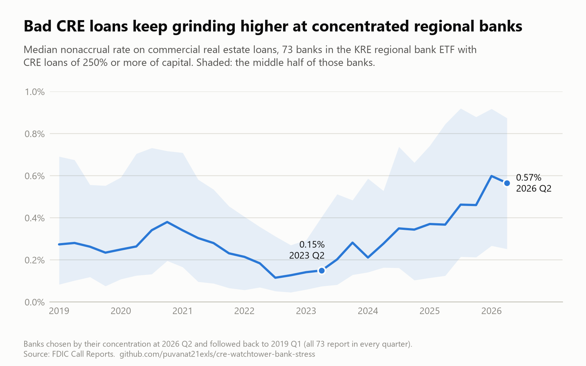
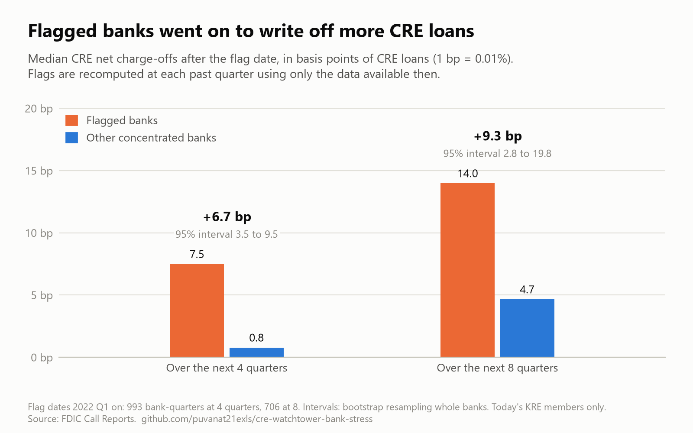

# 🏢 CRE Watchtower: Regional Bank Commercial Real Estate Stress Pipeline

A primary-source macro research and signal-detection system tracking Commercial Real Estate (CRE) exposure concentration and nonaccrual credit deterioration across **165 of the 167 constituents (190 bank charters)** of the KRE Regional Banking ETF, using quarterly FDIC Call Report data (**2019Q1–2026Q2**; 5,758 bank-quarters, including two banks that have since left the index). It adds daily bond-market and volatility readings and monthly CMBS distress data, and **backtests its own warning flags** against what happened next.

> Detection tool only: it shows where stress is building. It does not trade and is not investment advice.

---

## 📌 Research Question & Core Empirical Findings

With cheap 2021-vintage CRE loans maturing into the 2026–2027 "maturity wall" at elevated interest rates, this project measures bank-level exposure and the velocity of credit deterioration to identify systemic vulnerabilities, and then tests whether its flags actually foresee losses.

### Key Empirical Results (2026Q2 Data, N=162 Measurable KRE Names)

* **The Concentration Landscape:** The median regional bank holds a refined CRE concentration of **237.1%**. **33 banks (20%)** exceed the interagency 300% supervisory concentration guidance, and **73 banks (45%)** sit above the 250% watch line.
* **Exposure $\neq$ Deterioration ($r = 0.015$):** Within the flagged cohort ($\ge 250\%$, n = 73), the Spearman rank correlation between concentration level and nonaccrual deterioration slope is $r = 0.015$ ($p \approx 0.90$). Among already-concentrated banks, *how* concentrated a bank is says nothing about whose loans are going bad.
* **The Persistent Grind (0.15% $\rightarrow$ 0.57%):** For the 73 flagged banks, the median nonaccrual rate rose from 0.15% in 2023Q2 to 0.57% in 2026Q2, a steady grind rather than a cliff. It eased slightly in the latest quarter (0.60% $\rightarrow$ 0.57%). This pattern is *consistent with* loan extension activity ("extend & pretend") spreading recognition over time; the data here do not prove that mechanism.
* **The Flags Foresee Losses (backtest):** Banks tagged BURNING or IGNITING went on to record **higher CRE net charge-offs** than other concentrated banks: **+6.7 bp** over the next 4 quarters (95% interval 3.5 to 9.5) and **+9.3 bp** over 8 quarters (2.8 to 19.8). Details below.



A one-page summary of the project is in `results/cre_watchtower_summary_2026Q2.pdf`.

---

## 🔬 Methodology & Formula Definitions

### 1. Refined vs. Inclusive Concentration

$$\text{Refined Concentration (\%)} = \frac{\text{LNRECONS} + \text{LNREMULT} + \text{LNRENROT}}{\text{RBC}} \times 100$$

* **`LNRECONS`**: Construction & land development loans
* **`LNREMULT`**: Multifamily property loans
* **`LNRENROT`**: Non-owner-occupied nonfarm nonresidential loans
* **`RBC`**: Total Risk-Based Capital ($)

> **Why Refined?** Excluding owner-occupied CRE (`LNRENROW`) prevents distortion from businesses that own their premises (like dental offices), isolating tenant-reliant commercial property risk. The inclusive measure (using `LNRENRES` = `LNRENROW` + `LNRENROT`) is stored alongside it for comparison.

### 2. Multi-Bank Holding Company Aggregation

Multi-bank holding companies (BancFirst, International Bancshares, Popular, QCR, Wintrust; Wintrust alone has 16 charters) are aggregated across all member certificates in a given quarter **before** computing ratios. Looking at Wintrust's lead bank alone would cover only about 15% of the group's balance sheet.

### 3. Nonaccrual Trajectory & Composite Scoring

$$\text{Nonaccrual Rate (\%)} = \frac{\text{NARECONS} + \text{NARENRES} + \text{NAREMULT}}{\text{LNRECONS} + \text{LNRENRES} + \text{LNREMULT}} \times 100$$

For banks $\ge 250\%$ concentration, an Ordinary Least Squares (OLS) slope of the nonaccrual rate is computed across the latest 13 quarters (2023Q2–2026Q2). Banks are ranked via a composite score:

$$\text{Composite Score} = 0.50 \times \text{Pctile(Slope)} + 0.30 \times \text{Pctile(Level)} + 0.20 \times \text{Pctile(Acceleration)}$$

Each bank then receives a tag (2026Q2 counts in brackets):

| Tag | Meaning | Rule |
|---|---|---|
| **BURNING** (29) | Taking losses now | Nonaccrual level at or above the cohort median **and** slope above zero and at least the cohort median slope or 3 bp/quarter |
| **IGNITING** (1) | Bad loans starting to rise | Level below the median, slope in the cohort's top quarter, and level up versus the prior quarter |
| **SMOLDERING** (8) | High bad loans, not rising fast | Level at or above the median, slope flat, falling or slow |
| **QUIET** (35) | Exposed, bad loans low and steady | Everything else in the cohort |

### 4. Four-Signal Dashboard

| Signal | Source | Rule | Reading (2026-10-10) |
|---|---|---|---|
| **BANKS** | FDIC Call Reports (quarterly) | Quarter-on-quarter change in the cohort's median nonaccrual rate: RISING $\ge$ +5 bp, EASING $\le$ −5 bp | STABLE (−3.3 bp) |
| **VOL** | KRE, SPY, VIX closes (daily) | KRE 30-day realized volatility and VIX versus the past year: STRESSED above the 70th percentile, COMPLACENT below the 30th | COMPLACENT |
| **TREPP** | Trepp's public monthly CMBS reports | *Workout gap* = special servicing rate − delinquency rate; last 3-month average versus the prior 3, band ±0.20 pp | STABLE (3.55 vs 3.53 pp) |
| **BONDS** | FRED: `DGS10`, `DGS5`, `DGS2`, `BAMLC0A4CBBB`, `BAMLH0A0HYM2` (daily) | RATE_SHOCK if the 10-year yield rose $\ge$ 0.50 pp in 3 months; CREDIT_STRESS if the high-yield spread widened $\ge$ 1.00 pp | RATE_SHOCK (10Y 5.22%, +0.66 pp) |

Any signal reports **INSUFFICIENT DATA** instead of guessing when its inputs are missing.

---

## 📊 Backtest: Do the Flags Foresee Anything?

`backtest` goes back to every past quarter with a full 13-quarter window (2022Q1 onward), recomputes the tags using **only data available then**, and compares outcomes over the following 4 and 8 quarters. Intervals are 95% bootstrap intervals of the median difference, resampling whole banks.

| Test | Outcome | 4 quarters | 8 quarters |
|---|---|---|---|
| BURNING + IGNITING vs. rest of the cohort | CRE net charge-offs (bp of CRE loans) | **+6.7** [3.5, 9.5] | **+9.3** [2.8, 19.8] |
| BURNING + IGNITING vs. rest of the cohort | Change in nonaccrual rate (bp) | −13.4 [−22.6, −6.8] | −11.7 [−32.9, +3.9] |
| $>300\%$ vs. $\le 300\%$, all banks | Change in nonaccrual rate (bp) | +5.3 [0.8, 10.3] | +10.4 [3.3, 22.4] |
| $>300\%$ vs. $\le 300\%$, all banks | CRE net charge-offs (bp) | +0.9 [−1.0, 3.6] | +2.9 [−2.0, 10.5] |



**Reading it:** flagged banks' bad-loan share stops rising while their write-offs run higher. The tag marks banks in the *loss-taking phase*: the damage is being booked, not still building. The plain 300% rule points to banks whose bad loans grow more, but it does not separate who takes losses.

**Failed banks:** of 17 FDIC failures since 2020, 11 are testable. The tags flagged **3** in their last filings before failure (Signature Bank, Republic Bank, Community Bank & Trust – West Georgia). Silicon Valley Bank and First Republic were **not** flagged, as expected: they failed from deposit runs and interest-rate losses, not CRE.

**Limits:** only today's KRE constituents are tested (survivorship); observations from the same bank overlap; the sample covers one stress episode; figures use today's FDIC data, including later amendments.

---

## 📋 Current Watchlist (2026Q2, top of 73 flagged banks)

| # | Bank | Refined conc. | Nonaccrual | Slope (bp/qtr) | Tag |
|---|---|---|---|---|---|
| 1 | Banc of California | 291.3% | 4.24% | +24.7 | BURNING |
| 2 | Preferred Bank (Los Angeles) | 357.3% | 2.33% | +22.1 | BURNING |
| 3 | Shore Bancshares | 325.5% | 1.78% | +11.8 | BURNING |
| 4 | Bank OZK | 259.5% | 1.27% | +9.7 | BURNING |
| 5 | Flagstar Bank | 327.5% | 7.38% | +70.2 | BURNING |
| 31 | Bank of Marin Bancorp | 365.9% | 0.50% | +8.1 | IGNITING (the only one) |

The full ranked list of all 73 banks is in `results/watchlist_2026Q2.csv`.

> Tags are mechanical screens computed from public FDIC Call Report filings. They describe a pattern in reported numbers, not an opinion on any bank's soundness, and they are not investment advice.

---

## 🧪 Validation & Sanity Anchors

Re-checked on every `banks` and `slopes` run, from 2022Q4 Call Reports filed before the 2023 failures (inclusive-basis concentration; refined in brackets):

* **Signature Bank (CERT 57053):** **318.4%** (299.5%). High CRE concentration, correctly identified.
* **First Republic Bank (CERT 59017):** **193.8%** (186.1%). Elevated exposure.
* **Silicon Valley Bank (CERT 24735):** **15.7%** (13.4%). Low CRE exposure.

> **Sanity Check Note:** SVB's low reading shows the model isolates CRE credit risk and does not confuse it with duration mismatch or deposit-run risk.

Data-integrity rules built into the code: every FDIC and FRED field code is verified against its source dictionary before use; a missing value stays blank and is never treated as zero; every report states how many items it processed out of how many it tried; history files are append-only.

---

## 📁 Repository Architecture

```text
├── results/
│   ├── cre_watchtower_summary_2026Q2.pdf    # One-page summary with both charts
│   ├── chart_bad_loans_2026Q2.png           # Median nonaccrual rate of the 73 concentrated banks, 2019Q1–2026Q2
│   ├── chart_backtest_2026Q2.png            # Backtest: later charge-offs, flagged banks vs. the rest
│   ├── cre_watchtower_research_writeup.md   # Research write-up (July 2026) with October 2026 addendum
│   ├── watchlist_2026Q2.csv                 # All 73 flagged banks: concentration, nonaccrual, slope, tag
│   ├── backtest_2026Q2.txt                  # Full backtest output, including the failed-bank check
│   └── dashboard_2026-10-10.txt             # Latest four-signal dashboard snapshot
└── README.md
```

---

## 🔒 Code & Data Availability

This repository publishes the **results**. The pipeline code (four Python files: entry point, data collection, analysis, shared settings) and the full bank-level dataset are kept in a private repository and are **available on request**.

Everything here is built from public primary sources, so the results can be checked independently: FDIC BankFind Suite (Call Reports and bank failures), FRED (Treasury yields and ICE BofA credit spreads), State Street's KRE holdings file, Yahoo Finance closing prices, and Trepp's public monthly CMBS reports. The formulas and rules above are complete.
